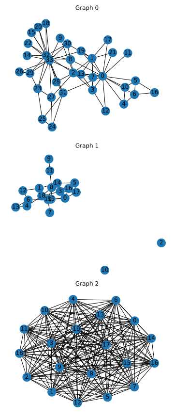

# Valori proprii

## Ex. 2
```bash
------ Graph 0 ------
Complet (eigv): False
Complet (from networkx): False
Bipartit (eigv): False
Bipartit (from networkx): False
Cliche size (eigv) - upper bound: 8.0
Cliche size (from networkx): 5

------ Graph 1 ------
Complet (eigv): False
Complet (from networkx): False
Bipartit (eigv): True
Bipartit (from networkx): True
Cliche size (eigv) - upper bound: 4.0
Cliche size (from networkx): 2

------ Graph 2 ------
Complet (eigv): True
Complet (from networkx): True
Bipartit (eigv): False
Bipartit (from networkx): False
Cliche size (eigv) - upper bound: 20.0
Cliche size (from networkx): 20
```


